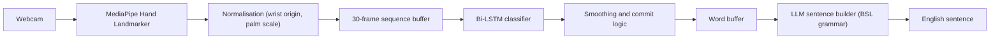

# Yani — Real-Time British Sign Language Translator

Yani is a real-time **British Sign Language (BSL) to English** translator. It watches a webcam feed, recognises signs using a custom-trained **bidirectional LSTM**, and uses an **LLM** to turn the recognised signs into natural English sentences that follow BSL grammar.

It's built to be **extensible**. To add a new sign, you record examples with the built-in data-collection tool and retrain. You don't need to change any code.

---

## ✨ Features

- **Real-time sign recognition.** Detects **35 BSL word signs** live from a standard webcam.
- **Hand tracking with MediaPipe.** Tracks up to 2 hands × 21 landmarks × (x, y, z), giving 126 features per frame.
- **Sequence modelling.** A 2-layer bidirectional LSTM classifies 30-frame gesture sequences, so it can recognise signs that involve movement, not just static poses.
- **Position- and scale-invariant.** Landmarks are centred on the wrist and scaled by palm size, so recognition works regardless of where you stand or how close you are to the camera.
- **Stable predictions.** Recency-weighted smoothing, confidence thresholds and commit cooldowns stop flickering and duplicate words.
- **BSL grammar via an LLM.** BSL uses topic–comment word order and drops function words. Yani sends the signed glosses (e.g. `[your, name, what]`) to an LLM, which produces fluent English ("What is your name?").
- **Resilient API layer.** Retries automatically when rate-limited (HTTP 429), cleans up the model's output, and falls back to joining the words in order if the API is unavailable.
- **Add new signs without code changes.** Add a sign to `bsl_words.json`, record examples with your webcam and retrain. The model's output layer and label encoder adjust automatically.
- **Desktop UI.** A dark-themed CustomTkinter app shows the live video feed, the detected sign, the word buffer and the translated sentence.
- **Benchmarked.** Built-in tooling measures inference latency, per-class validation accuracy and LLM round-trip time.

---

## 🧠 How It Works



### Model architecture (`train_lstm.py`)

| Layer | Details |
|---|---|
| Input | `(30, 126)` landmark sequence |
| Bi-LSTM 1 | 128 units, return sequences, dropout 0.2 + LayerNorm |
| Bi-LSTM 2 | 64 units, return sequences, dropout 0.2 + LayerNorm |
| Temporal pooling | Global average pooling |
| Dense | 128 → 64 (ReLU, dropout) |
| Output | Softmax over sign classes |

Training uses balanced class weights, early stopping, learning-rate reduction on plateau, and checkpointing of the best model.

---

## 📁 Project Structure

| File | Purpose |
|---|---|
| `bsl_translator_ui.py` | **Main app**: real-time translator with a CustomTkinter UI |
| `sentence_builder.py` | LLM integration that turns BSL glosses into English sentences |
| `data_collection_lstm.py` | Webcam tool for recording 30-frame sequences for each sign |
| `train_lstm.py` | Trains the bidirectional LSTM word-sign model |
| `bsl_words.json` | Sign vocabulary and signing hints (edit this to add new signs) |
| `measure_performance.py` | Benchmarks latency, accuracy and API round-trip time |
| `test_bsl.py` | Test suite |
| `test_detection_lstm.py` | Command-line live detection with the LSTM model |
| `train.py` / `data_collection.py` | Static fingerspelling (alphabet) classifier and data collection |
| `train_words.py` / `data_collection_words.py` | Static word-sign classifier (earlier approach) |
| `convert_kaggle_dataset.py` / `convert_slingo_dataset.py` | Extract landmarks from external image datasets |
| `download_dataset.py` / `preprocess_data.py` | Dataset download and preprocessing utilities |

---

## 🚀 Getting Started

### 1. Install dependencies

```bash
python -m venv tf-env
tf-env\Scripts\activate        # Windows
pip install -r requirements.txt
pip install customtkinter pillow
```

### 2. Add your Gemini API key

The sentence builder looks for the key in this order:

1. The `GEMINI_API_KEY` environment variable
2. `bsl_data/gemini_api_key.txt`

Without a key, Yani still works but just joins the signed words in order.

### 3. Collect data and train

```bash
python data_collection_lstm.py   # record sequences for each sign
python train_lstm.py             # train the Bi-LSTM
```

### 4. Run the translator

```bash
python bsl_translator_ui.py
```

**Controls**

| Key | Action |
|---|---|
| `Enter` | Build a sentence from the word buffer |
| `Z` | Undo the last word |
| `C` | Clear the buffer |
| `Esc` | Quit |

---

## ➕ Adding a New Sign

1. Add an entry to `bsl_words.json`:
   ```json
   "water": "W-hand taps chin"
   ```
2. Record examples:
   ```bash
   python data_collection_lstm.py
   ```
   Use `N` / `P` to move between signs and `Space` to record a sequence.
3. Retrain:
   ```bash
   python train_lstm.py
   ```
4. Restart the translator. The new sign is recognised straight away.

---

## 📊 Benchmarking

```bash
python measure_performance.py
```

Reports:
- **LSTM inference latency** (average, min and max over 50 runs)
- **Validation accuracy**, overall and per class
- **LLM API round-trip time**

---

## 🛠️ Tech Stack

**Python · TensorFlow / Keras · MediaPipe · OpenCV · scikit-learn · NumPy · Pandas · Gemini API · CustomTkinter**

---

## 📌 Supported Signs

afternoon, and, baby, bad, book, brother, come, daughter, eating, father, go, good, hello, home, how, luck, meet, morning, mother, my, name, night, old, phone, sister, son, step, summer, sunrise, sunshine, thanks, what, where, you, your

---

## 👤 Author

**Abdul Hannan Khan**, BSc Computer Science, Nottingham Trent University
Final-year project
